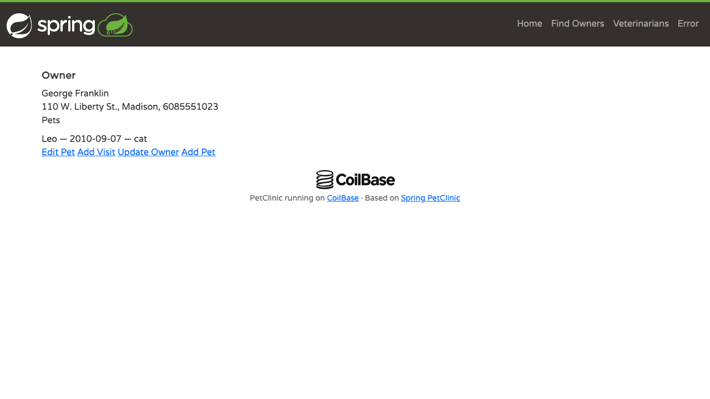

# CoilBase PetClinic

A [CoilBase](https://github.com/PVRLabs/coilbase) port of [Spring PetClinic](https://github.com/spring-projects/spring-petclinic/tree/500158f732419217507c7656904b8e6aa1bcc0d6), using explicit services, SQL and JTE templates. This is a reference application, not a production-hardened deployment.

The application supports owner search and editing, pets, visits, and veterinarian pages. It uses Avaje Jex routes, Jdbi-backed repositories, explicit service transactions and JTE templates. The [migration guide](docs/migration.md) explains these choices and their trade-offs. The [shared HTTP contract](contract/README.md) compares representative workflows with the pinned Spring application.

In a small PostgreSQL experiment, the CoilBase application reached a database-backed owner page in a median 2.63 seconds, compared with 19.76 seconds for Spring. Application RSS medians were 125.9 MiB and 304.4 MiB respectively. These results compare complete applications under one short exploratory workload. They do not measure framework overhead or production capacity. See the [benchmark](benchmark/README.md) for the method, results and limitations.



The owner detail page uses the sample data and static assets from Spring PetClinic.

More screenshots are available in [docs/images](docs/images/).

## Run locally

Requires Java 25 and Maven. Run from this directory:

```sh
./run.sh
```

Open http://localhost:8080. The script builds the application and initializes a dedicated H2 database in `.demo-db/` on first launch. Subsequent launches preserve changes. If `PETCLINIC_DB` is set, the script uses that database without initializing it; configure its schema and credentials separately. The application never initializes its schema automatically. Set `PORT`, `PETCLINIC_DB_USER` and `PETCLINIC_DB_PASSWORD` as needed. For the local H2 demo, the script defaults `PETCLINIC_SECURE_COOKIE` to `false` for HTTP. With an external database, the application keeps its secure-cookie default unless explicitly configured.

## Build and deploy

`mvn clean package` runs the tests and produces the thin executable JAR in `target/`, its runtime dependencies in `target/lib/`, and `target/petclinic-1.0-SNAPSHOT-deployment.tar.gz`. The archive contains the JAR, `lib/` and license notices. Extract it and run `java -jar petclinic-1.0-SNAPSHOT.jar` with a configured, initialized database. It does not include fixtures or initialize the database.

For PostgreSQL, create a disposable database and initialize it with `src/test/resources/postgres/schema.sql` and `data.sql` using `psql`; set `PETCLINIC_DB` to its JDBC URL and configure credentials. PostgreSQL tests run when `PETCLINIC_TEST_POSTGRES_URL`, `PETCLINIC_TEST_POSTGRES_USER` and `PETCLINIC_TEST_POSTGRES_PASSWORD` are set for a disposable database whose user can create and drop schemas. Otherwise they are skipped.

Run `python3 scripts/check.py` after packaging for isolated H2 HTTP and restart checks. Sessions and flash are in-memory and single-process; restarts discard them. The application does not provide authentication.

The measured application JAR SHA-256 was `076e77c96910b07493dc4349a9fb8c99967f71e5891294a2060726797391840b`. The public version adjusts the navigation brand markup and adds a footer credit after measurement. A rebuild may produce different bytes. Static assets and fixtures derive from the pinned upstream project; see [LICENSE](LICENSE) and [third-party notices](THIRD-PARTY-NOTICES.md).
