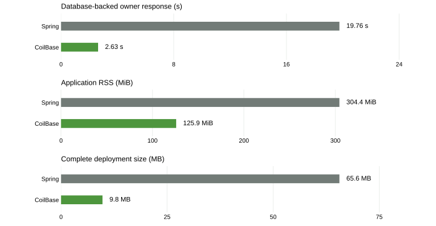

# PetClinic performance observations

On this small, warm-host PostgreSQL deployment, the CoilBase port reached both the root page and a database-backed owner page faster and used less application RSS than the pinned Spring application. In a short sequential read-only workload its median request time was lower for seven of eight paths; the cached Spring vet JSON was faster on the eighth. These are observations of two complete applications and their selected dependencies and defaults, not isolated framework costs or capacity limits.

Owner response is the median of three launches from the separate database-readiness follow-up. RSS is the median during the workload and quiet interval. Deployment size includes the uncompressed application JAR and runtime libraries. Each chart has its own zero-based scale.

The observations below are from the original measurement and its separate follow-up. The original recorded interval was 2026-11-11 01:57:54–02:00:59 UTC; the database-backed readiness follow-up ran at 02:10:21–02:11:36 UTC after a VM restart and fresh smoke checks. The local x86-64 Lima VM had one vCPU, 1 GiB allocated, 959 MiB guest memory and no swap. Both applications ran sequentially with Temurin 25.0.4.1+1, `-Xms64m -Xmx256m`, and PostgreSQL 18.6 in the same VM. The JVM chose Serial GC ergonomically for both; the recorded effective flags and application GC logs are in the private experiment archive. PostgreSQL used 128 MiB shared buffers, 100 maximum connections and 4 MiB work memory. Separate databases had matching pinned fixtures and `C.UTF-8` collation.

| Observation | Spring | CoilBase |
| --- | ---: | ---: |
| Complete deployed files, uncompressed | 65,607,443 bytes / 94 files | 9,775,305 bytes / 23 files |
| HTTP-root response, three observations | 16.23, 15.26, 15.15 s | 1.18, 1.17, 1.18 s |
| Median HTTP-root response | 15.26 s | 1.18 s |
| Database-backed owner response, three follow-up observations | 15.19, 19.76, 28.90 s | 2.48, 2.63, 2.79 s |
| Median database-backed owner response | 19.76 s | 2.63 s |
| Application RSS, median during workload and quiet | 304.4 MiB | 125.9 MiB |
| PostgreSQL summed process RSS, same interval | 297.6 MiB | 297.2 MiB |
| Host MemAvailable, same interval | 301.5 MiB | 480.6 MiB |

The original HTTP-root measurement ends at the first 200 from `/`. It does not establish database readiness: CoilBase initializes its Hikari pool only when a database-backed request arrives, while Spring initializes its database components during startup. The separate follow-up measures from process launch to the first complete 200 response from `/owners/1` containing `Franklin`, thereby exercising the database-backed owner workflow. The probe polls every 100 ms with a two-second request timeout; the original six application logs show Hikari initialization and Serial GC. The follow-up reused the same artifacts, JVM policy and matching databases but followed a VM restart and fresh smoke checks. Its timings are not paired with the earlier root timings, and Spring’s three observations varied substantially; no cause was established.

Each memory median combines one-second samples from the recorded request sequence and the following ten-second quiet period: 13 samples for Spring and 11 for CoilBase. The short workload means quiet samples dominate. PostgreSQL summed RSS double-counts shared pages and must not be added to application RSS or treated as actual database consumption. The values describe the configured JVM and process state; they are not framework minimums. Spring used its efficient extracted layout, and both sizes include their complete runtime library directories.

Each path received 20 serial requests after one warm-up cycle, with all recorded requests returning 200. The client ran in the same one-vCPU guest, followed redirects, and timed complete response reads. Times below are per-path medians, not a concurrent throughput or tail-latency test:

| Path | Spring median | CoilBase median |
| --- | ---: | ---: |
| Welcome `/` | 7.78 ms | 2.85 ms |
| Owner search form | 10.37 ms | 1.81 ms |
| Search Franklin (including redirect) | 38.18 ms | 9.54 ms |
| Owner details | 23.03 ms | 5.11 ms |
| Owner edit form | 20.35 ms | 5.61 ms |
| New pet form | 46.10 ms | 7.13 ms |
| Vet HTML | 15.23 ms | 9.54 ms |
| Vet JSON | 5.84 ms | 9.21 ms |

The response bodies also differ in size. These are the bytes read by the client for each completed response (after any redirect):

| Response | Spring | CoilBase |
| --- | ---: | ---: |
| Welcome | 2,658 bytes | 989 bytes |
| Owner details | 4,180 bytes | 1,278 bytes |
| New pet form | 4,499 bytes | 2,083 bytes |
| Vet JSON | 797 bytes | 797 bytes |

Spring's HTML responses are larger for these pages. Rendering, transferred bytes and other application differences are part of the measured request times; the results do not isolate HTTP-framework overhead.

Spring caches vet data, while the port does not; the portability review also documented differing relationship queries. Application behavior, libraries, template engines and query patterns all contribute to these outcomes. The workload does not measure writes, concurrency, sustained load or scheduling interference from the developer host. The shared correctness suite previously exercised writes and database behavior independently; it is not a performance test. Further workload-specific tuning or different JVM, database and resource choices could change these results.

The first Spring startup completed, but its analysis encountered a final sample after the process exited. The timing and earlier samples were preserved, the collector shutdown was corrected and smoke-tested, and the remaining runs continued in a new release. The extra pause and smoke run warmed the host between the first and later observations. One short run per workload and three observations per readiness endpoint do not establish repeatability across hosts or days. The first observation and later phases were recorded in separate runs.

Measured JAR SHA-256: CoilBase `076e77c96910b07493dc4349a9fb8c99967f71e5891294a2060726797391840b`; Spring extracted `40d3d91e7f7b0a806620c9fb192e8794019478354761c96355ec7d1f358da56d`; Spring fat JAR `441403c1cf1d5ef2da751c7b9aaeedd8374d3a0ec7a64e24e6b14acee2554e1a`. The public version adjusts the navigation brand markup and adds a footer credit after measurement. A later build may have different bytes; these results remain those of the measured application.

Selected original workload summaries and readiness observations are available in [evidence](evidence/). Application and GC logs remain in the private experiment archive; they are not included in this package.
